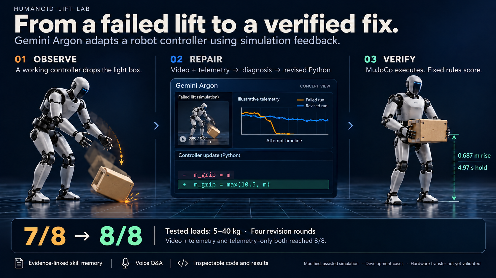
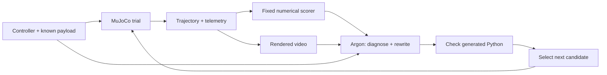

# Humanoid Lift Lab

**Gemini 4 Argon fixes a humanoid's lift in simulation before deployment: it watches failed lifts in MuJoCo, diagnoses the physics, rewrites a readable controller, and a deterministic physics scorer decides whether the fix holds.**

The motivating use case is lift-and-shift work in small businesses, workshops and households: boxes, stock and furniture parts, often without an on-site robotics engineer. A controller tuned for one load can drop another. Lift Lab explores adapting the controller in simulation before considering deployment. The implemented task is **lifting a box in place**; walking, carrying, placing and hardware deployment remain future work.

The current product is a controller-adaptation and debugging workbench for robotics engineers. Its central output is a revised, readable program together with the evidence used to evaluate it.



*Presentation illustration; robot artwork and telemetry curves are conceptual. Numerical outcomes come from the recorded development trials below. [Download the image](submission/project-story.png) · [Generation prompt](submission/story-image-prompt.txt).*

## Demo videos and links

| | Link |
| --- | --- |
| **Results site** (every round, critique and video; embedded 60-second demo) | https://humanoid-lift-lab.onrender.com |
| **60-second narrated demo** (submission video) | https://humanoid-lift-lab.onrender.com/assets/humanoid-lift-lab-60s.mp4 |
| **Live demo, part 1**: a chat/voice request runs in MuJoCo, fails, and Argon watches the video and diagnoses it | https://www.loom.com/share/529241066a694e6c90bc78e6818e0f40 |
| **Live demo, part 2**: Argon's rewrites are re-tested against the 11 lb box and the 33/66 lb regression checks | https://www.loom.com/share/c2def0c1658049b190d012b0ff24cce2 |
| **Replay of the 15:52 live run that passed** (saved real results, labelled REPLAY on screen): 11 lb fixed in 4 attempts, two regressing rewrites discarded | https://www.loom.com/share/e5cbc5935e594e2cb92b87527f2c089a |
| Recorded results | [submission/results.json](submission/results.json) |

The Render site is static. The live demo (`demo.app`) and the voice companion (`voice.app`) are local Python services; see *Run locally*.

## What it does

1. Start with an engineer-written controller or a generated program over the supplied humanoid API.
2. Simulate the lift and record trajectories, grip slip, joint effort, balance, and assistance.
3. Render the actual trajectory as hero/side video with telemetry overlays.
4. Give Argon the controller, trial evidence, and history. The video condition includes rendered video; the text condition receives telemetry only.
5. Execute the rewritten Python controller and score it with fixed criteria. Optional `--keep-best` revises the strongest previous candidate when a new program regresses.

The simulator, scene, inverse kinematics, and motion primitives are supplied engineering. Argon generates task-level control programs; it does not learn motor weights from scratch or infer payload mass from images.

## Implementation



The telemetry-only condition omits video from the model request. Both conditions receive numerical outcomes and attempt history.

### What is supplied and what Argon changes

| Component | Implementation |
| --- | --- |
| Physics and robot assets | MuJoCo and Menagerie/Unitree G1 geometry, with project-specific scene, stronger actuators and assistance |
| Motion primitives | Our Python API for posture interpolation, leg geometry, arm inverse kinematics, squeeze and coordinate conversion |
| Initial behavior | An engineer-written [reference controller](sim/reference_controller.py) for the successful adaptation comparison |
| Argon's contribution | Diagnosis and revised Python sequencing, grip, posture, clearance and timing parameters over that API |
| Verification | Our trajectory-based scorer, recorded evidence, keep-best selection and live regression checks |

No model weights are trained or fine-tuned. The successful experiment adapts a working reference; it does not establish controller discovery from scratch.

### Execution and evidence

- **Controller execution:** [sim/trial.py](sim/trial.py) launches a child process, constructs the humanoid and calls the generated `run(robot)` function. Physics uses a 1 ms timestep, with a 30 s simulation cap and a 240 s wall-clock watchdog.
- **Motion API:** [sim/humanoid_api.py](sim/humanoid_api.py) exposes `squat`, `hands_to`, `squeeze`, `set_posture`, `wait` and state queries. These methods advance the simulation; Argon is not queried at every physics step. Hand targets use pelvis coordinates, while box poses are returned in world coordinates.
- **Recording:** `traj.npz` stores joint positions, time, assistance, joint-effort ratios, balance margin, slip and phase at 30 fps. `result.json` stores scores; `child.json` records execution errors and placement jitter. [loop/telemetry.py](loop/telemetry.py) produces timestamped summaries.
- **Video:** [sim/render.py](sim/render.py) replays the saved trajectory rather than running a second physics trial. Critic videos use hero/side views with telemetry overlays; the Argon request samples video at 2 fps.
- **Model interaction:** [loop/argon.py](loop/argon.py) calls `gemini-4-argon` using background Interactions requests and the Files API for video. Prompts include the goal, API documentation, physics guidance, known payload mass, current code, scores, telemetry and history. Video mode adds selected rendered attempts.
- **Revision:** Argon returns a timestamped diagnosis, proposed changes and a complete fenced Python program. Compile/AST checks require the controller entry point; an invalid response can receive a repair request. These checks are not a security sandbox or a physical-correctness proof.
- **Candidate selection:** [loop/run_loop.py](loop/run_loop.py) can retain the strongest previous candidate using pass count plus bounded partial lift progress. The live path additionally checks two anchor loads. These mechanisms reduce regressions but do not guarantee that the last candidate passes.

### Example: repairing the light-box failure

The reference controller passed 10–40 kg but dropped the 5 kg box. Its squeeze formula scaled force with mass, so the light box received relatively little grip preload. Argon proposed a minimum preload together with clearance and posture changes.

The final [video-conditioned controller](submission/controllers/video_adapt.py) uses `m_grip = max(10.5, m)`, increasing the requested 5 kg squeeze from approximately **84 N to 177 N per palm**. It also changes hand retraction, lift height and lean-back parameters. The revised program passed the recorded sweep. This validates the combined program under those conditions; the contribution of each individual edit has not been isolated.

## Recorded adaptation results

Eight tested loads: **11, 22, 33, 44, 55, 66, 77, 88 lb** (5–40 kg in steps of 5 kg). The hand-written reference lifted 22–88 lb but dropped the light 11 lb box. Both conditions started from the same hand-written reference; the seed schedule was base seed 0 plus mass index.

| Condition | Pass counts, rounds 0 → 4 | Final result | Logged model-cost estimate |
| --- | --- | --- | --- |
| Video + telemetry | 7 → 0 → 3 → 6 → 8 | **8/8 passes** | $0.2557 |
| Telemetry only | 7 → 0 → 0 → 6 → 8 | **8/8 passes** | $0.1766 |

Four revision rounds means five evaluated controller versions, including round 0. Both runs initially regressed before recovering. The video run's 11 lb (5 kg) case improved from a drop to a 0.6867 m rise held for 4.966 s. Final controller snapshots and recorded metrics are in [submission/](submission/).

Cost figures are logged estimates for those model requests, not total project costs. Simulation, rendering, uploads and generation contribute to wall time; this is an offline repair loop, not a real-time motor-control system.

**Scope:** these are development trials in a modified G1-based, assisted simulation. Joint strength is increased and assistance is explicitly budgeted. They are not stock-G1 hardware ratings or held-out generalization results. Since both conditions reached 8/8, this experiment does not establish video superiority. Earlier attempts from a weak baseline were unsuccessful; the working reference is an important prior.

### Scoring and physical assumptions

| Criterion | Requirement |
| --- | --- |
| Box rise | At least 0.45 m above its starting height |
| Hold | At least 3 contiguous seconds at sufficient height |
| Falls and drops | Neither allowed; pelvis below 0.45 m is a fall |
| Assistance | Mean balance assistance at most 60 N-equivalent |
| Execution | No controller or physics error |

The numerical scorer decides from simulator state, independently of Argon's written critique. Argon receives the criteria; they are not secret tests.

The model retains G1-like body masses but uses increased joint strength. A grip helper applies paired palm forces, capped at 450 N per palm, plus an inward IK offset. Balance assistance includes external forces and torque-equivalent support. The 60 N-equivalent limit is a whole-trial mean, not a peak-force limit. These are explicit modeling assumptions, not validated hardware capabilities. See [calibration](docs/calibration.md) and [evaluation protocol](docs/evaluation-plan.md).

### Saved live example

Separate live run `155234_m5` repaired the 5 kg lift on attempt 4: **0.6942 m rise and 4.8 s hold**, while the 15 kg and 30 kg checks also passed. Intermediate rewrites regressed and were discarded as the next starting point. Another saved live run ended in a fall. The successful replay is an inspectable example, not a guarantee for a new request or the source of the 8/8 batch result.

## Run locally

The project was developed on macOS with Python 3.14. Offscreen rendering requires a working graphics environment.

```bash
python3 -m venv .venv
.venv/bin/python -m pip install -r requirements.txt
```

Set `GEMINI_API_KEY` in the environment or an untracked project `.env` for new model requests.

**Saved evidence and voice explanations:**

```bash
.venv/bin/python -m voice.app
```

Open http://127.0.0.1:8791/. The saved-evidence panel works without API calls and has a committed fallback snapshot for fresh clones. New questions use Argon for text/audio understanding and Gemini TTS for speech. [Voice guide](docs/voice.md).

**Live payload request and repair loop:**

```bash
.venv/bin/python -m demo.app --no-viewer
```

Open http://127.0.0.1:8790/ and type or say a request such as `lift an 11 pound box` (a bare number means pounds; explicit kg is also supported). Requests are rounded to 0.5 kg within the 5–40 kg task range. Each attempt also tests two anchor loads selected from 15, 30 and 20 kg, excluding near-duplicates of the requested load; the 5 kg example uses 15 and 30 kg (33 and 66 lb). The page shows what Argon watched, its timestamped diagnosis and the code diff. Keep-best selection can reuse an earlier controller after a regression. New repair attempts make paid Argon calls, and a fix is not guaranteed within the default 3 revision rounds. Omit `--no-viewer` to launch the native MuJoCo viewer on the development Mac; it replays completed trial trajectories.

**Replay a saved live run** (no new simulation or model calls; labelled REPLAY on the page), while `demo.app` is running:

```bash
.venv/bin/python -m demo.replay 155234_m5
```

Raw `runs/live/` is git-ignored, so this works on the machine that recorded the run.
Replay writes the same page state as a live repair; run one at a time. Replay timing is presentation timing, not a new model-latency measurement.

**Reproduce an adaptation condition in a new output directory:**

```bash
.venv/bin/python -m loop.run_loop --arm video --rounds 4 --keep-best --workers 2 \
  --seed-controller sim/reference_controller.py --run-dir runs/reproduce_video
```

Use `--arm text` and a separate directory for the telemetry condition. These commands run new simulations and paid model requests; they do not guarantee reproduction of the same generated programs. Use the committed [final controller snapshots](submission/controllers/) to inspect the actual submitted programs without regeneration.

**Static results page:** `python3 -m http.server 8080 --directory viz`. Static hosting does not run either local Python service.

## Evidence and memory

`sim/` implements the environment, motion API, scorer, and renderer; `loop/` contains Argon prompting, telemetry, and the revision runner. `evals/` supplies artifact collection, provenance checks, and development validation. Raw `runs/` are ignored; selected evidence, source hashes, the video, and a portable earlier-memory-pilot snapshot are committed.

The optional ASPIRE-inspired memory stores guidance, tags and references to validated development evidence in JSON. Admission checks controller/environment/artifact hashes and excludes stubs and held-out data. Retrieval uses bounded, deterministic lexical matching with environment filtering. It was tested in a separate expert-reference pilot; it is not automatically enabled in every loop and is not the cause claimed for the latest adaptation result. That pilot supplied the full expert reference, so it does not isolate a memory-system benefit. [Memory documentation](docs/skill-memory.md).

The voice companion is a separate evidence-inspection path: recorded audio or typed question → Argon answer grounded in selected saved results → Gemini TTS speech. It does not launch controller repairs. The packaged fallback evidence for fresh clones covers the earlier memory pilot, not the latest 8/8 adaptation sweep.

Artifact collection distinguishes real, stub and uncertain-provenance runs. Prospective development validation can fingerprint an environment before execution and independently rescore its saved trajectory afterward. Those tools do not retroactively turn historical development runs into a held-out benchmark. See [data collection](docs/data-collection.md) and [development validation](docs/development-validation.md).

Google products used: Gemini 4 Argon, Gemini API/Interactions and Files API, Gemini 3.8 Flash TTS, MuJoCo, and the Menagerie G1 base model. The live demo's browser speech recognition is distinct from the native Argon-audio voice companion. Third-party model notices remain in [sim/g1/LICENSE](sim/g1/LICENSE). ASPIRE is methodological inspiration, not a claimed reproduction or integrated benchmark.

## Repository map

| Path | Purpose |
| --- | --- |
| [sim/](sim/) | Robot scene/assets, motion API, controllers, trial runner, scorer and renderer |
| [loop/](loop/) | Argon integration, prompts, telemetry, revision orchestration and optional memory |
| [demo/](demo/) | Local payload-request UI, live repair runner, viewer and labelled replay |
| [voice/](voice/) | Saved-evidence audio/text Q&A and speech generation |
| [evals/](evals/) | Run audits, data collection, validation and memory pilot |
| [viz/](viz/) | Static results site served by Render |
| [submission/](submission/) | Final controllers, recorded results and the demo video |
| [docs/AGENT_CONTEXT.md](docs/AGENT_CONTEXT.md) | Shared architecture, experiment boundaries and agent handoff |

## What remains to validate

The current evidence supports reference-seeded controller adaptation on seen development cases. It does not establish video superiority, an isolated memory benefit, generalization to unseen loads/layouts, or hardware safety.

The next evaluation should freeze the simulator and prompts, separate development and test conditions, repeat independent generations, vary placement/friction/box geometry, and compare video with and without the numeric HUD. Assistance metrics and generated-code isolation also need further work before investigating calibrated hardware transfer. The [evaluation plan](docs/evaluation-plan.md) describes proposed work rather than completed benchmark results.

## Checks

```bash
.venv/bin/python -m unittest discover -s tests -q
node --check voice/client.js
```

The submission video is exactly 60.0 s, H.264/AAC, 1280x720, with Gemini TTS narration and burned-in captions. It combines actual application captures and saved trial replay; it is not a continuous live recording. Its [manifest](submission/demo-manifest.json) identifies the footage.
